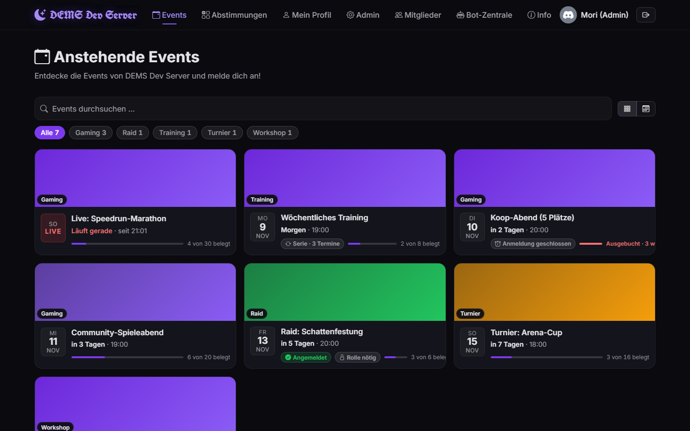

# DEMS – Dein Event-Management-System

[](https://hub.docker.com/r/moritakahashi/dems)
[](https://hub.docker.com/r/moritakahashi/dems/tags)
[](https://hub.docker.com/r/moritakahashi/dems)

DEMS plant die Events deiner Discord-Community: Mitglieder melden sich mit Discord an und tragen sich auf der Website oder direkt in Discord ein, der Bot kündigt Events an, erinnert und räumt hinterher auf. Du hostest DEMS selbst – kostenlos und Open Source (MIT).



> DEMS ist ein unabhängiges Projekt und steht in keiner Verbindung zu Discord Inc. „Discord“ ist eine Marke von Discord Inc.

## 🚀 Funktionen

**Für Mitglieder**

*   Login mit dem Discord-Konto, kein eigenes Passwort.
*   Anmelden auf der Website oder direkt in Discord – per Button in der Ankündigung oder mit `/anmelden`. Events mit Formular öffnen in Discord ein Popup mit denselben Feldern.
*   Warteliste mit Nachrücken: Wird ein Platz frei, bekommt ihn der Nächste per DM angeboten und bestätigt mit einem Klick.
*   „Vielleicht“ sagen, ohne einen Platz zu belegen, und Gäste mitbringen.
*   Check-in per Code auf der Event-Seite oder per Button in Discord.
*   Profil mit kommenden Events, Verlauf und Statistik; Erinnerungs-DMs, die jeder selbst ein- und ausschalten kann.
*   Terminabstimmungen, Kommentare zu jedem Event (auf Wunsch gespiegelt in einen Discord-Thread) und ein Neuigkeiten-Dialog nach jedem Update.

**Für Admins**

*   Events mit Banner, Plätzen, Rollen-Slots, Rollen-Voraussetzungen, Anmeldeschluss und eigenem Formular; Serien, Vorlagen und Entwürfe.
*   Anmeldungen annehmen, ablehnen oder auf die Warteliste setzen – einzeln, gesammelt oder in einem Freigabe-Kanal in Discord.
*   Mitgliederübersicht, Auswertungen, CSV-Export und Audit-Log.
*   Bot-Zentrale für alle Nachrichten und Schalter, Wartungs- und Panic-Modus.
*   Einrichtung und Systemeinstellungen im Browser, ohne Konfigurationsdateien.

**In Discord**

*   Ankündigungen mit Buttons „Anmelden“ und „Zum Event“, eigener Diskussions-Thread pro Event.
*   Slash-Commands: `/anmelden`, `/abmelden`, `/meine-events`, `/events`, `/event info`, `/abstimmungen`; für Admins `/event erstellen` und `/abstimmung erstellen`.
*   Erinnerungen per DM, private Event-Kanäle und Event-Rollen, Discord-Server-Events, die mit DEMS synchron bleiben.
*   Nach dem Event entfernt der Bot Kanäle und Rollen wieder.

## 🐳 Selbst hosten

### Was du brauchst

*   Einen Server mit [Docker](https://docs.docker.com/get-docker/) (inkl. Compose), z. B. einen kleinen VPS. Das Image [`moritakahashi/dems`](https://hub.docker.com/r/moritakahashi/dems) liegt öffentlich auf Docker Hub und läuft auf `amd64` und `arm64`.
*   Eine Domain mit **HTTPS** davor, z. B. über Caddy, Traefik oder den Proxy deines Hosters. Ohne HTTPS funktionieren Login und Einrichtung nicht.
*   Eine Discord-Anwendung im [Developer Portal](https://discord.com/developers/applications) und Rechte zum Verwalten deines Discord-Servers. Wie du sie anlegst, zeigt dir der Einrichtungsassistent Schritt für Schritt.

### Installieren

```bash
mkdir dems && cd dems
curl -O https://raw.githubusercontent.com/VibeGenZero/DEMS/main/compose.yaml
docker compose up -d
docker compose logs dems | grep Setup-PIN   # nach ein paar Sekunden
```

1.  Compose startet drei Dienste: die Datenbank (PostgreSQL, Passwort wird beim ersten Start zufällig erzeugt), einen kleinen Helfer dafür und DEMS selbst auf Port 3000.
2.  Leite deine Domain per HTTPS-Proxy auf Port 3000 weiter. Ein vollständiges Beispiel mit Traefik steht in [`docs/wiki/ops/deployment.md`](docs/wiki/ops/deployment.md).
3.  Öffne `https://<deine-domain>`, gib die Setup-PIN aus dem Log ein und folge dem Assistenten: Discord-Anwendung, Bot einladen, Server-ID, Adresse, Admin-Rolle. Die Werte speichert DEMS in der Datenbank.

Danach meldest du dich mit Discord an. Wer auf deinem Discord-Server „Administrator“ ist oder die gewählte Admin-Rolle hat, ist in DEMS Admin.

### Aktualisieren

```bash
docker compose pull && docker compose up -d
```

*   Admins sehen unter **Admin › System**, wenn es eine neuere Version gibt. Dafür fragt DEMS zweimal am Tag die öffentlichen GitHub-Releases ab, ohne Daten über deine Installation. Abschalten mit `UPDATE_CHECK=false` in der `.env`.
*   Was sich geändert hat, steht in den [Releases](https://github.com/VibeGenZero/DEMS/releases) und nach dem Update im Neuigkeiten-Dialog der App.
*   Vorabversionen (Beta, Release Candidate) bekommst du mit `DEMS_TAG=beta` in der `.env`; Standard ist `latest`, die fertigen Releases.

### Sichern

```bash
docker compose exec -T postgres pg_dump -U dems dems > dems-backup.sql                                       # Datenbank
docker run --rm -v dems_dems-data:/data -v $PWD:/backup alpine tar czf /backup/dems-uploads.tgz -C /data .  # hochgeladene Banner
```

Die Daten liegen in den Volumes `dems-pg` (Datenbank), `dems-data` (Banner) und `dems-secrets` (Datenbank-Passwort). Sie überleben Neustarts und Updates; `docker compose down -v` löscht sie.

### Konfiguration

Alles Nötige stellst du im Einrichtungsassistenten und später unter **Admin › System** ein. Wer lieber mit Dateien arbeitet, legt neben `compose.yaml` eine `.env` an: Ein dort gesetzter Wert hat Vorrang und ist in der Oberfläche gesperrt. Alle Variablen mit Erklärung stehen in [`.env.example`](.env.example), zum Beispiel `DEMS_PORT` (anderer Host-Port), `TIMEZONE` oder `DISCORD_THREAD_SYNC` (Kommentare mit Discord-Threads spiegeln).

### Aus dem Quellcode bauen

Statt das fertige Image zu ziehen, kannst du es im geklonten Repo selbst bauen:

```bash
git clone https://github.com/VibeGenZero/DEMS.git && cd DEMS
docker compose -f compose.yaml -f compose.build.yaml up -d --build
```

Bisher aus dem Quellcode gebaut? `compose.yaml` zieht jetzt das veröffentlichte Image, `--build` allein baut nichts mehr. Wer weiter selbst baut, nimmt `git pull && docker compose -f compose.yaml -f compose.build.yaml up -d --build`.

### Probleme

| Problem | Lösung |
| --- | --- |
| Die Seite bleibt beim Laden hängen | DEMS über `https://<domain>` öffnen, nicht über `http://<ip>:3000`. |
| Nach dem Discord-Login wieder auf der Login-Seite | Der Proxy muss HTTPS sprechen und `X-Forwarded-Proto` setzen. |
| Discord lehnt den Bot ab („Used disallowed intents“) | Im Developer Portal unter „Bot“ den „Server Members Intent“ einschalten. |
| Werte aus der `.env` kommen nicht an | Die `.env` muss neben `compose.yaml` liegen; danach `docker compose up -d --force-recreate`. |

Mehr Hilfe im [Deployment-Wiki](docs/wiki/ops/deployment.md#troubleshooting).

## 🔒 Sicherheit

Sicherheitslücken bitte nicht als öffentliches Issue melden, sondern privat über GitHub – wie das geht, steht in der [Security Policy](SECURITY.md).

## 🧪 Entwicklung

DEMS ist ein Node.js-Prozess (Express-API, statisches Frontend ohne Build-Schritt, discord.js-Bot) mit PostgreSQL in Produktion und SQLite für Entwicklung und Tests. Zum Ausprobieren ohne Discord und ohne Datenbank:

```bash
git clone https://github.com/VibeGenZero/DEMS.git && cd DEMS
npm install
npm run dev:mock     # http://localhost:3000 mit Test-Personas und Beispiel-Events
npm test             # alle Tests
```

Node.js 22 oder neuer. Der Mock-Modus simuliert Discord, `npm run dev:reset` setzt die Beispieldaten zurück, `docker compose -f compose.dev.yaml up --build` startet ihn im Container. Aufbau, Regeln und Anleitungen stehen im Wiki unter [`docs/wiki/index.md`](docs/wiki/index.md), die Projektregeln in [`CLAUDE.md`](CLAUDE.md).

Beiträge sind willkommen: Issues und Pull Requests gern auf Deutsch.

## 📝 Lizenz & Credits

Entwickelt von **Mori Takahashi** (Lyonel Berzen).
Dieses Projekt ist unter der [MIT Lizenz](LICENSE) veröffentlicht.
