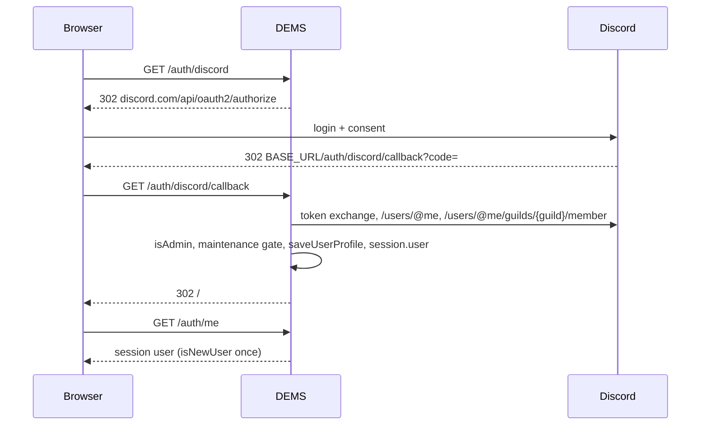

# Authentication, session and CSRF

> TL;DR: Login is Discord OAuth2 only (or the persona login in dev mock mode). The result is a server-side `express-session` (MemoryStore, 24 h cookie) holding `req.session.user = { id, username, displayName, avatar, roles, isAdmin, isNewUser }`. Admin = member has `DISCORD_ADMIN_ROLE_ID` at login time. Mutating `/api/*` requests need the per-session CSRF token in the `X-CSRF-TOKEN` header.

## Login sequence

## Session

- Store: default MemoryStore → lost on restart; not shared across processes.
- Cookie: `connect.sid`, `httpOnly`, `sameSite: 'lax'`, `secure: false`, `maxAge` 24 h.
- `isAdmin` and `roles` are snapshots from login; Discord role changes need a re-login.
- `isNewUser` is `true` only on the first `/auth/me` after the very first login → frontend shows `#firstLoginModal` (asks for `acceptInvitations`).
- Logout: `GET /auth/logout` destroys the session.

## Guards

`requireAuth` (401) and `requireAdmin` (403) in `middleware/auth.js`; the SPA additionally hides admin navigation (`showLoggedIn`) — UI hiding is not security, the API guards are.

## CSRF (double submit)

- Every request gets `req.session.csrfToken` (32 random bytes hex) and the readable cookie `XSRF-TOKEN`.
- POST/PUT/DELETE/PATCH on `/api/*` must send `X-CSRF-TOKEN` (or `X-XSRF-TOKEN`) equal to the session token → else 403 "Ungültiges CSRF-Token".
- `/auth/*` routes are GET-only and not CSRF-protected.
- Frontend: `fetchCSRFToken()` at boot, header added manually in each `fetch`.

## Dev mock mode

`dev/devAuth.js` replaces the OAuth round trip with `/auth/dev-login/:personaId` and produces the identical session shape; see [dev-mock-mode](../modules/dev-mock-mode.md).

## Known weaknesses (audit 2026-04-22, still open)

No OAuth `state` (H-01), no session regeneration after login (H-02), 24 h admin cache (H-03), `secure: false` cookie (C-03), logout via GET (L-07). Details: [security](security.md).
