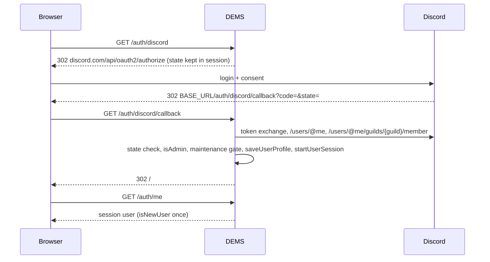

# Authentication, session and CSRF

> TL;DR: Login is Discord OAuth2 only (or the persona login in dev mock mode). The result is a server-side `express-session` (stored in the database by `PersistentSessionStore`, 24 h cookie) holding `req.session.user = { id, username, displayName, avatar, roles, isAdmin, isNewUser }`. Admin = member has `DISCORD_ADMIN_ROLE_ID` at login time. The login checks a one-time OAuth `state` and starts a fresh session (`startUserSession`). Mutating `/api/*` and `/auth/*` requests (logout) need the per-session CSRF token in the `X-CSRF-TOKEN` header.

## Login sequence

## Session

- Store: `PersistentSessionStore` (`utils/sessionStore.js`) in the collection `sessions` → logins survive restarts and deploys. Write-through memory cache: the database is read only for sessions this process does not know yet (after a restart). No `touch` (express-session would call it on every unchanged request = one write each), so a session expires with its cookie, 24 h after its last change. One process only: the cache is the source of truth.
- Cookie: `connect.sid`, `httpOnly`, `sameSite: 'lax'`, `maxAge` 24 h; `secure` only with `NODE_ENV=production` (also for `XSRF-TOKEN`). Production must sit behind a TLS proxy that sends `X-Forwarded-Proto: https` (`trust proxy` 1), otherwise express-session sends no cookie and the login does not stick.
- Login: `startUserSession(req, user)` (`middleware/auth.js`) regenerates the session (new id → a session id planted before the login is worthless) and mints its CSRF token at once; parallel first requests after the login would otherwise each mint their own token and all but one get 403.
- `isAdmin` and `roles` come from the login and are re-read from Discord at most every 5 minutes (`createRoleRefresh` in `middleware/auth.js`, registered after the static files): a revoked or new admin role takes effect within 5 minutes, a member who left the server keeps no roles. If Discord cannot answer (`fetchMemberRoleIds` → `null`), the session keeps its values and the check is retried a minute later; parallel requests of one user share one lookup. `session.user.rolesCheckedAt` holds the time of the last check.
- `isNewUser` is `true` only on the first `/auth/me` after the very first login → frontend shows `#firstLoginModal` (asks for `acceptInvitations`).
- Logout: `POST /auth/logout` with CSRF token destroys the session; the frontend `logout()` then loads `/`. A plain GET does not log out.

## Guards

`requireAuth` (401) and `requireAdmin` (403) in `middleware/auth.js`; the SPA additionally hides admin navigation (`showLoggedIn`) — UI hiding is not security, the API guards are.

## Privacy consent (#138)

While a privacy policy exists (`privacyPolicy/current`, `utils/privacyPolicy.js`; written by admins on `#system` or in the setup wizard, every changed text = next version), a logged-in member whose accepted version is lower must accept it first:

- `privacyGate` (`middleware/privacy.js`, in `server.js` after the role refresh) answers every `/api/*` request with 403 `{ error: 'Bitte akzeptiere zuerst die Datenschutzerklärung.', privacyRequired: true }` — admins included — except `/api/privacy`, `/api/user/privacy/accept`, `/api/csrf-token`, `/api/server-info`, `/api/maintenance/status`, `/api/updates`. `/auth/*` is never gated. A failing lookup lets the request through.
- The current version comes from memory; the accepted one from `req.session.user.privacyAcceptedVersion`. A session without that field (every new login, sessions from before #138) reads `users/<id>.privacyAcceptedVersion` once (`null` = never accepted).
- `/auth/me` adds `privacyRequired` and `privacyVersion` (and never returns `privacyAcceptedVersion`).
- `POST /api/user/privacy/accept { version }`: only the current version (409 otherwise, also without a policy); stores `privacyAcceptedVersion` + `privacyAcceptedAt` on the user and in the session.
- SPA: `finishLoading` → `checkAuth` → `settlePrivacyConsent()` waits in `#privacyConsentModal` (static backdrop, no Escape) before maintenance check and routing; the news and first-login popups follow the consent (`showLoginPopups`). „Ablehnen und abmelden“ calls `logout()`. `watchPrivacyAnswers()` (set up in `main.js`) wraps `window.fetch` once: a 403 with `privacyRequired` during the visit (a new version) reopens the dialog and re-runs the route after the consent.
- Discord interactions (registration button, modal, slash commands) are not gated.

## CSRF (double submit)

- The token (32 random bytes hex) is minted only by `GET /api/csrf-token` (the SPA calls it at boot) and at login (`startUserSession`); every response for a session that has one sets the readable cookie `XSRF-TOKEN`. Requests without a session cookie create no session, so pages, assets and crawlers write nothing to the database.
- POST/PUT/DELETE/PATCH on `/api/*` and `/auth/*` must send `X-CSRF-TOKEN` (or `X-XSRF-TOKEN`) equal to the session token → else 403 "Ungültiges CSRF-Token".
- `/auth/*`: only `POST /auth/logout` mutates; it is protected like `/api/*`.
- Frontend: `fetchCSRFToken()` at boot, header added manually in each `fetch`.

## Dev mock mode

`dev/devAuth.js` replaces the OAuth round trip with `/auth/dev-login/:personaId` and produces the identical session shape; see [dev-mock-mode](../modules/dev-mock-mode.md).

## Known weaknesses (audit 2026-04-22, still open)

None of the login findings. OAuth `state` (H-01), session regeneration (H-02), `secure` cookie (C-03), logout via POST (L-07) (all F-05), the MemoryStore (L-02, F-06) and the 24 h admin cache (H-03, F-15) are fixed. Details: [security](security.md).
