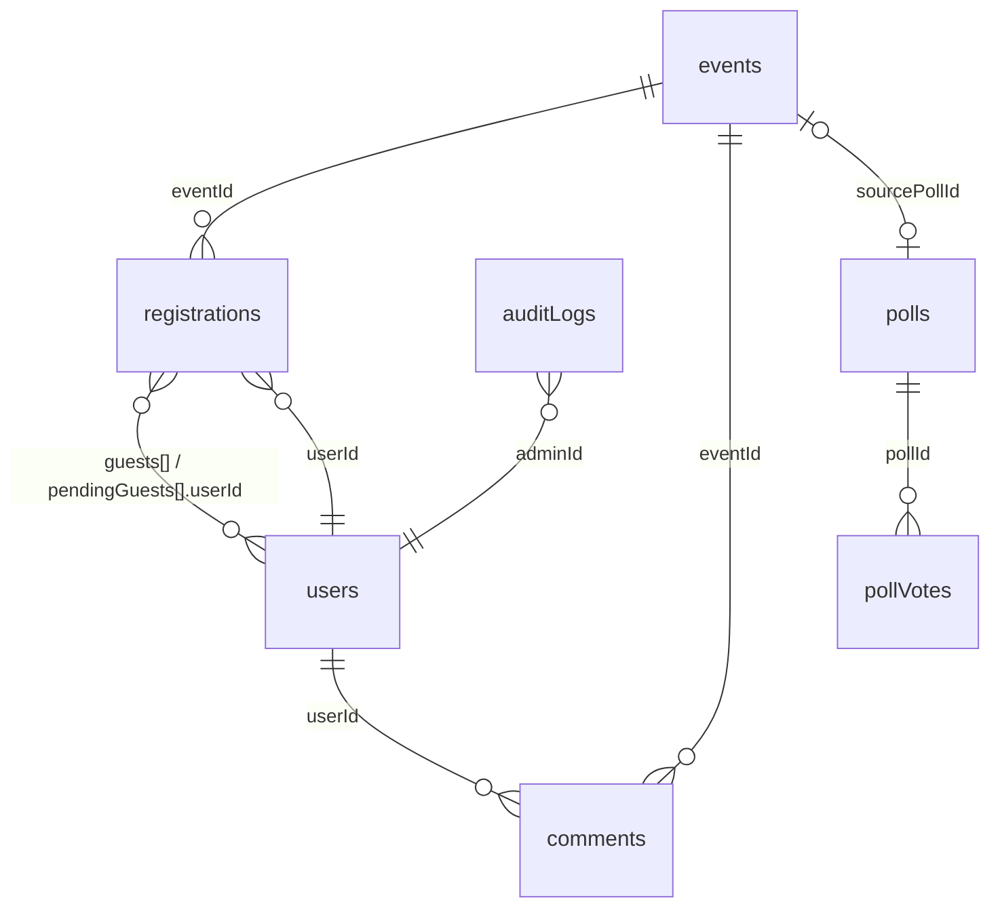

# Data model — collections and document shapes

> TL;DR: Twelve schemaless collections. `events`, `registrations`, `comments`, `auditLogs`, `polls`, `eventTemplates` use auto ids; `pollVotes` uses `<pollId>_<userId>`; `users` uses the Discord user id; `botMessages/templates`, `botSettings/config`, `maintenanceSettings/config` are singleton documents; `devMeta/seed` exists only in dev mock mode. All dates are ISO-8601 strings. Shapes are defined by the code that writes them (no schema file) — the producers are listed per collection.

## events (auto id) — written by `POST/PUT /api/admin/events*`

| Field | Type | Meaning |
|---|---|---|
| `title`, `description` | string | description is Markdown (EasyMDE), ≤5000 chars |
| `status` | `draft` \| `active` \| `archived` \| `cancelled` | only `active` is listed and accepts registrations; `draft`/`archived` answer 404 to non-admins (`isEventVisibleTo`) |
| `startDate`, `endDate` | ISO string or `''` | |
| `registrationDeadline`, `unregisterDeadline` | ISO string or `''` | optional Anmeldeschluss / Abmeldeschluss (W-03); `''` or missing = none; must lie before the end; series dates keep the distance to their start |
| `maxParticipants` | int | `0` = unlimited; guests count against it |
| `accessMode` / `requiredRoles` | `open` \| `role-required` / role id[] | role gate for registration |
| `approvalMode` | `manual` \| `instant` | `instant` → accepted directly, `manual` → pending |
| `assignRoleId` | role id or `''` | role given on acceptance, removed on unregister |
| `formFields` | `[{ label, type, required, options[], description }]` | see [form-fields](form-fields.md) |
| `allowGuests` | bool (default true) | |
| `category` | string | UI only, not validated |
| `bannerUrl` | string | empty, an external http(s) URL or the path `/uploads/banners/<uuid>.<ext>` of an uploaded banner (W-12; file in `UPLOAD_DIR`, see [utils](../modules/utils.md)); checked by `validateEvent`. Series and duplicates copy the value, so several events can share one file |
| `accentColor` | string | hex colour only (`validateEvent`) |
| `location` | `{ text, channelId, channelType }` or `null` | |
| `reminderHours` | `[{ hours, sent }]` (legacy: number, normalized by `utils/reminders.js`) | `sent` is the only duplicate protection; kept on save while `startDate` is unchanged — see [reminders-presence](reminders-presence.md) |
| `customBotMessages` | `{ registration?, accepted?, rejected? }` | per-event DM templates |
| `checkinMessage` / `checkinEnabled` / `checkinCode` | string / bool / 6-digit string | code never leaves the admin area (`toPublicEvent`); admins read it via `checkin-stats` |
| `autoCreateChannels`, `channelConfig` | bool, `{ type: voice\|text\|both, voiceName?, textName? }` | private event channels |
| `discordChannelId`, `discordTextChannelId`, `discordScheduledEventId` | id or null | set by the bot |
| `recurring`, `recurringInterval`, `recurringUntil`, `seriesId` | bool, `weekly`\|`biweekly`\|other=monthly, `YYYY-MM-DD`, uuid | series instances share `seriesId` |
| `eventStartNotificationSent` | bool | start DM sent once |
| `registrationClosedRefreshed` | bool | announcements refreshed once after the registration deadline (W-03); reset when an edit moves the deadline (`keepDeadlineRefreshFlag`) |
| `sourcePollId` | poll id or `''` | date poll the event was created from (informative) |
| `slots` | `[{ id, name, emoji, capacity }]` or absent | role slots, see [role-slots](role-slots.md); with slots `maxParticipants = Σ capacity` and `allowGuests = false` |
| `announcements` | `[{ channelId, messageId }]` (max 5) | Discord announcements that are kept up to date live |
| `createdAt`, `createdBy`, `updatedAt` | ISO, user id, ISO | |

## registrations (auto id) — written by `utils/registrationService.js`

`{ eventId, userId, userName, status: pending|accepted|waitlisted|rejected, formAnswers: { [fieldLabel]: string|boolean }, guests: userId[], pendingGuests: [{ userId, displayName, avatar, status: pending|accepted }], source: web|discord|admin (admin = entered by an admin, W-06), createdAt, checkedIn?, checkedInAt? (code or admin check-in; only `accepted` registrations carry one, cleared to `false`/`null`), slotId?, preferredSlotId?, altSlotIds? }`

Slot fields exist only on slot events: `slotId` = the slot actually taken (`null` on the waitlist), `preferredSlotId` = main role, `altSlotIds` = fallback roles in slot order.

## users (id = Discord user id) — written by `utils/userProfile.js`, `bot.js#ensureUserProfile`

`{ id, username, displayName, avatar (URL), acceptInvitations (bool), notifications?: { reminders, changes, waitlist } (bool each, W-16; missing field or key = on), welcomeSentAt? (ISO, B-02: the bot center welcome message was sent; written by `utils/botSettings.js#sendWelcomeOnce`), createdAt, updatedAt }`

Read in full by the admin member overview (W-15, `GET /api/admin/members`, `utils/memberOverview.js`): `createdAt` shows as "Dabei seit", `updatedAt` (login or settings save) and the registration times give "Letzte Aktivität".

## comments (auto id) — `POST /api/events/:id/comments`

`{ eventId, userId, userName, userAvatar, text (≤1000), isAdmin, replyTo (comment id|null), createdAt }` — `userAvatar` is the session avatar URL at posting time; comments written before F-11 store it wrapped (`cdn.discordapp.com/avatars/<id>/<URL>.png?size=64`), `GET /api/events/:id/comments` unwraps it.

## auditLogs (auto id) — `utils/eventUtils.js#addAuditLog`

`{ action, adminId, details, targetId, timestamp }`. Actions: `CREATE_EVENT`, `UPDATE_EVENT`, `NOTIFY_EVENT_CHANGE`, `UPDATE_EVENT_STATUS`, `CANCEL_EVENT`, `START_EVENT`, `END_EVENT`, `DELETE_EVENT`, `DELETE_SERIES`, `DUPLICATE_EVENT`, `GENERATE_CHECKIN`, `EXPORT_REGISTRATIONS`, `MESSAGE_PARTICIPANTS` (W-09), `UPDATE_REGISTRATION_STATUS`, `MOVE_REGISTRATION_SLOT`, `CREATE_POLL`, `UPDATE_POLL`, `CLOSE_POLL`, `ANNOUNCE_POLL`, `DELETE_POLL`, `DECIDE_POLL`, `ANNOUNCE_EVENT`, `SYNC_DISCORD_EVENT`, `UPDATE_TEMPLATES` (bot messages), `CREATE_EVENT_TEMPLATE`, `UPDATE_EVENT_TEMPLATE`, `DELETE_EVENT_TEMPLATE` (W-10), `UPDATE_BOT_SETTINGS`, `UPDATE_MAINTENANCE`, `PANIC_MODE_ACTIVATED`, `PANIC_MODE_DEACTIVATED`.

## polls (auto id) — written by `routes/admin.js` and `utils/pollStore.js`

`{ title, description, options: [{ id, startDate, endDate }], deadline, status: open|closed|decided, accessMode, requiredRoles, labels: { yes, maybe, no }, winnerOptionId, eventId, announcements, createdBy, createdAt, updatedAt, closedAt }` — see [date-polls](date-polls.md).

## pollVotes (id = `<pollId>_<userId>`) — written by `utils/pollStore.js#savePollVote`

`{ pollId, userId, userName, yes: optionId[], maybe: optionId[], updatedAt }`; an empty vote is deleted.

## sessions (id = SHA-256 of the session id) — written by `utils/sessionStore.js`

`{ data (JSON text of the express-session data: cookie, user, csrfToken, oauthState), expiresAt (ISO), updatedAt }`. Expired documents are deleted when read and every 6 h (`pruneExpired`). Not seeded, and neither `npm run dev:reset` nor the admin system reset wipes them — logins survive both.

## eventTemplates (auto id) — written by `routes/admin.js` (`/api/admin/event-templates`, W-10)

`{ name (unique ignoring case, ≤ 80), settings, createdAt, createdBy, updatedAt, updatedBy }` — shared by all admins, at most 50. `settings` holds only `TEMPLATE_FIELDS` of `utils/eventTemplates.js` with event shapes (see the events table): `title`, `description`, `bannerUrl`, `accentColor`, `category`, `location`, `maxParticipants`, `accessMode`, `requiredRoles`, `approvalMode`, `allowGuests`, `slots`, `assignRoleId`, `formFields`, `reminderHours` (`[{ hours }]`, no `sent`), `checkinMessage`, `autoCreateChannels`, `channelConfig`, `customBotMessages`. Never dates, deadlines, status, series fields, Discord ids, announcements or the check-in code. Applying a template in the wizard copies the settings once; events keep no link to it. An uploaded banner in `settings.bannerUrl` counts as used for the banner clean-up. Not wiped by the admin system reset.

## Singletons

| Document | Fields |
|---|---|
| `botMessages/templates` | `registration`, `accepted`, `rejected` (template strings, ≤2000) |
| `botSettings/config` | `statusType`, `activityType`, `activityText`, `dmNotifications`, `reminderEnabled`, `eventStartNotifications`, `autoChannelCreation`, `autoUpdatePresence`, `autoStatusCalendarEvents`, `announceChannel`, `welcomeMessage`, `updatedAt` |
| `maintenanceSettings/config` | `warningEnabled`, `warningText`, `loginDisabled`, `registrationDisabled`, `plannedMaintenance`, `plannedMaintenanceStart/End/Text`, `panicMode`, `panicActivatedAt`, `panicActivatedBy`, `updatedAt`, `updatedBy` |
| `devMeta/seed` (mock only) | `seededAt` |

## Gotchas

- `formAnswers` is keyed by the field **label** — renaming a form field orphans existing answers in UI and CSV.
- `botSettings/config` is read through `utils/botSettings.js` (defaults for missing keys, cached until the next save); every switch has an effect since B-02 — see [reminders-presence](reminders-presence.md).
