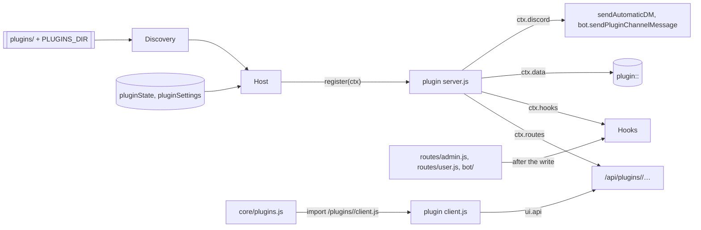

# Plugin SDK — architecture, lifecycle, security model

> TL;DR: A plugin is one folder with a `plugin.json` (+ optional `server.js`, `client.js`, `client.css`, `assets/`). Official plugins come from `<app>/plugins` (shipped in the image, chip „Offiziell“), custom ones from `PLUGINS_DIR` (default `data/plugins`, on the volume). Plugins run **in the DEMS process without a sandbox**, but reach DEMS only through a permission-checking `ctx` (server) and `ui` (browser) with plain-data in/out, so isolation can be added later. `plugin-sdk/host.js` discovers, validates and loads them at startup (`register(ctx)` with 5 s timeout), admins switch them in System › Plugins (custom: trust dialog + reset password + audit log), `PLUGINS_SAFE_MODE=true` runs no plugin code (plugins can then only be switched off). SDK 1.0 = routes, own data (reserved `userId` → purged on account deletion), settings, seven hooks, rate-limited DMs/channel posts, a tab page, the event editor prefilled with an origin. SDK 1.1 (`sdk: 1.1`) adds `ctx.registrations` + hook `registration.checkedIn` (`registrations:read`), guarded Discord roles (`discord:roles`), `ctx.members.search` and `ctx.profile.badges` (plugin badges on the member's profile). Writing one: [write-plugin](../howto/write-plugin.md).

Spec: [2026-11-19-plugin-sdk-design](../../superpowers/specs/2026-11-19-plugin-sdk-design.md) (#155). Where this page and the spec differ, this page follows the code.

## Architecture

| Part | File | Does |
|---|---|---|
| entry | `plugin-sdk/index.js` | `initPlugins(options)` (once, in `server.js` after migrations, system config and AI settings, before `listen`; a failure never blocks the start), `pluginHost()` for routes |
| manifest | `plugin-sdk/manifest.js` | `validateManifest(raw, folder, { fileExists })`, `PERMISSIONS` (with German labels), `SETTING_TYPES`, `SDK_VERSION = 1`, `SDK_MINOR = 1`, `SDK_VERSIONS = [1, 1.1]`, `SDK_1_1_PERMISSIONS` |
| discovery | `plugin-sdk/discovery.js` | `discoverPlugins({ officialDir, customDir })`: every sub-folder with `plugin.json`; official first; a custom folder with an official id → „Ungültig: Die ID gehört einem offiziellen Plugin.“ |
| host | `plugin-sdk/host.js` | lifecycle, on/off, admin views (`views.js`), settings validation, data delete, `purgeUser`, `wipeAllData`, `reportError`; one write chain per plugin (state writes are read-merge-write) |
| state | `plugin-sdk/state.js` | `pluginState/<id>` and `pluginSettings/<id>` (see [data-model](data-model.md)) |
| ctx | `plugin-sdk/context.js`, `data.js`, `discord.js`, `theme.js`, `themeCss.js` | the server API, built once per plugin (a fresh one only for a retry after a failed `register`); `theme.js` + `themeCss.js` store allow-list-filtered CSS in `pluginThemes` |
| hooks | `plugin-sdk/hooks.js`, `plugin-sdk/coreHooks.js` | per-plugin queues; the core's emit helpers (`safeEmit`, `emitEventCreated`, `emitRegistrationCheckedIn`, …) and the `pluginOrigin` check |
| members | `plugin-sdk/members.js` | `ctx.members.get/search` (`toPluginMember`: name = display, user or global name) |
| profile | `plugin-sdk/profile.js` | `validatePluginBadges`, `collectPluginBadges` for `GET /api/user/profile` (SDK 1.1) |
| registrations | `plugin-sdk/registrations.js` | `ctx.registrations.list({ eventId, userId })` and `toPluginRegistration` (SDK 1.1) |
| errors | `plugin-sdk/errors.js` | `PluginPermissionError`, `PluginDataError`, `PluginHttpError` (`ctx.httpError`), `PluginHostError` (German messages) |
| API | `routes/plugins.js` | `GET /api/plugins` (client list) + dispatcher `/api/plugins/<id>/…` (on/off checked per request; optional `password: true` admin reset password guard; a handler that has not answered after 30 s → 504 „Das Plugin hat nicht rechtzeitig geantwortet.“ + `lastError`, its late result is dropped) |
| theme CSS | `routes/pluginTheme.js`, `public/design-boot.js`, `public/js/core/pluginTheme.js` | `GET /theme.css` (public, ETag + `no-cache`) and `GET /theme-preview.css` (admin only, `no-store`) linked as `#custom-theme` in `<head>`, escape hatch `?design=standard` in `design-boot.js`, `ui.theme` + `#design-preview-bar` |
| files | `routes/pluginStatic.js` | `/plugins/<id>/client.js`, `client.css`, `assets/<name>` of switched-on plugins only |
| admin API | `routes/adminPlugins.js` | `GET /api/admin/plugins`, `PUT …/:id/enabled`, `PUT …/:id/settings`, `DELETE …/:id/data` — see [routes-admin](../modules/routes-admin.md) |
| browser | `public/js/core/plugins.js`, `public/js/core/passwordDialog.js` | `loadPlugins()` (after the privacy consent), the `ui` object, pages at `#p/<id>`, navbar tabs, core reset password dialog `#passwordModal` — see [frontend-app](../modules/frontend-app.md) |
| admin UI | `public/js/admin/system-plugins.js` | System › Plugins (cards, switch, trust dialog `#pluginTrustModal`, settings, „Daten löschen“) |
| reference plugins | `plugins/event-submissions/`, `plugins/custom-design/`, `plugins/badges/`, `plugins/event-feedback/` | „Event einreichen“, „Design anpassen“, „Badges“ and „Event-Feedback“ (official; the last two use SDK 1.1, see below) |

## Lifecycle

| Situation | What happens |
|---|---|
| start | discover both folders, read `pluginState`; only plugins that are **on and confirmed** get their `server.js` required; `register(ctx)` must settle within 5 s — a throw/timeout → status „Fehler: …“, `lastError` stored, plugin off, DEMS continues |
| switch on (admin) | official: at once; custom: needs `trust: true` + reset password and stores `confirmedVersion`/`confirmedPermissions`. First use requires + registers; switching on again reuses the first registration (Node cannot unload a module); after a failed `register` it retries with a fresh `ctx` and clears the old error |
| switch off | routes answer 404 `Plugin nicht gefunden.`, hooks are skipped (gate checked right before each handler), client no longer listed or served, `ctx.onDisable` callbacks run (2 s each); data and settings stay |
| custom plugin changed on disk | `version` ≠ `confirmedVersion` or a permission not in `confirmedPermissions` → starts off with „Bestätigung nötig“ until switched on again. Official plugins skip this check |
| new folder / new code | discovery and `require` happen only at start: restart DEMS after adding or changing a plugin |
| image update brings a new official plugin | starts off (no state) |
| dev mock mode | an official plugin without state is switched on and stored at start |
| `PLUGINS_SAFE_MODE=true` | no plugin code runs; every card shows „Abgesicherter Modus aktiv“, `/api/plugins` `[]`, routes and files 404; switching **on** is refused (409 „Abgesicherter Modus aktiv – Plugins lassen sich nicht einschalten.“), switching **off** works (stores `enabled: false`, audit `PLUGIN_DISABLE`, runs no plugin code) — only the switch of a plugin stored on is enabled (the view's `enabled`). Recovery from a plugin that breaks the start: restart with `PLUGINS_SAFE_MODE=true`, switch the broken plugin off in System › Plugins, remove the line, restart |
| folder gone | the state entry (or its collections) stays as card „Verwaist“: no switch, no settings, „Daten löschen“ also removes the state entry |

Status chips (`plugin-sdk/views.js`): `off` Aus, `on` An, `error` Fehler: …, `confirm` Bestätigung nötig, `invalid` Ungültig: <Grund>, `incompatible` Inkompatibel (SDK <n>), `orphaned` Verwaist, `safe` Abgesicherter Modus aktiv. A runtime error (route 500, hook throw) keeps the plugin on and shows `lastError` + time as a warning line; the message limit shows „Nachrichtengrenze erreicht (bis HH:MM)“, the role limit „Rollengrenze erreicht (bis HH:MM)“ (both joined with „ · “).

## Permissions (SDK 1.1)

`plugin.json` names `sdk: 1` or `sdk: 1.1` (`SDK_VERSIONS` in `plugin-sdk/manifest.js`); 1.1 only adds to 1.0, so every 1.x plugin runs. The two 1.1 permissions need `sdk: 1.1`, else „Ungültig: Die Berechtigung „…“ braucht SDK 1.1.“ (`SDK_1_1_PERMISSIONS`). Known limit: DEMS 3.4.x shows a `sdk: 1.1` manifest as „Ungültig: SDK-Version fehlt.“

A missing permission throws `PluginPermissionError` („Dem Plugin fehlt die Berechtigung „…“.“). In-process this is a guard rail, not a wall.

| Permission | Allows | Shown as |
|---|---|---|
| `events:read` | `ctx.events.get/list`, the six `event.*` hooks | „Events lesen“ |
| `events:draft` | `ui.openEventEditor` with an origin; `pluginOrigin` accepted on create | „Events für das Team vorbereiten“ |
| `members:read` | `ctx.members.get`, `ctx.members.search` (SDK 1.1) | „Mitgliedernamen und Avatare lesen“ |
| `discord:dm` | `ctx.discord.sendDM` | „Direktnachrichten über den Bot senden“ |
| `discord:channel` | `ctx.discord.sendChannelMessage` | „Nachrichten in Discord-Kanäle posten“ |
| `theme` | `ctx.theme.saveDraft/discardDraft/publish/clear`, `ui.theme.showPreview/hidePreview/reload/isStandardMode` | „Aussehen der ganzen Seite ändern“ |
| `network` | nothing in `ctx`; declares internet access | „Verbindungen ins Internet aufbauen“ |
| `registrations:read` (SDK 1.1) | `ctx.registrations.list`, hook `registration.checkedIn` | „Anmeldungen lesen“ |
| `discord:roles` (SDK 1.1) | `ctx.discord.listRoles/addRole/removeRole` | „Discord-Rollen vergeben und entziehen“ |

Routes, own data, own settings, `member.deleted`, the page/tab, `ctx.audit` and `ctx.log` need no permission. Not in SDK 1.1 (planned 1.2): Discord commands/buttons/modals, `ctx.schedule`, event page panel, registration status hooks.

## Hooks

Emitted by the core **after** the write is committed, never awaited by the request; each plugin has its own promise chain (handlers run in emission order, one slow plugin never delays another), each handler gets its own `structuredClone` of the payload, runs in `try/catch` (error → log + `lastError`), > 10 s logs a warning, after 30 s it counts as failed („Hook <name> hat nicht innerhalb von 30 s geantwortet.“ → log + `lastError`) and the plugin's queue goes on — the handler cannot be stopped and keeps running in the background. A plugin registers at most 20 handlers per hook (`MAX_HANDLERS_PER_HOOK`; the 21st makes `register` fail), which bounds the synchronous copies one emission makes. Event payloads: public event shape (`toPublicEvent`, no `checkinCode`) + `origin`.

| Hook | Payload | Emitted by (pinned by `test/pluginHookEmission.test.js`) |
|---|---|---|
| `event.created` | `{ event }` | create (each series date, also `fromPoll`), duplicate, series extension, Discord `/event erstellen` |
| `event.published` | `{ event }` | status becomes `active` from `draft` or new (create as active, `PUT …/status`, `PUT …/:id`, `POST …/start`, Discord draft buttons) |
| `event.updated` | `{ event, changed }` | `PUT …/:id` when a field (other than `updatedAt`) changed |
| `event.ended` | `{ event }` | status becomes `archived` (`POST …/end`, `PUT …/status`, `PUT …/:id`, auto-archive) |
| `event.cancelled` | `{ event }` | status becomes `cancelled` (`PUT …/cancel`, `PUT …/status`, `PUT …/:id`) |
| `event.deleted` | `{ eventId, origin }` | `DELETE …/:id`, series delete (per date) |
| `member.deleted` | `{ userId }` | `DELETE /api/user/account`, after the core purge; reaches every switched-on plugin |
| `registration.checkedIn` (SDK 1.1, needs `registrations:read`) | `{ registration, eventId }` (`registration` in the shape of `ctx.registrations`) | a member's own check-in after it is stored: `checkInMember` in `utils/checkin.js` (code check-in `POST /api/events/:id/checkin`, Discord „Einchecken“ button) and `PUT /api/admin/registrations/:id/checkin` with `checkedIn: true` without `guestId`; never for a repeat, an undo or a guest (`emitRegistrationCheckedIn` in `coreHooks.js`) |

A new event counts as coming from `draft`, a stored one without status as `active` (ruling R6). The admin system reset emits no hooks. Details per code path: [event-lifecycle](event-lifecycle.md#plugin-hooks).

## Security model

1. **Two trust levels.** Official = reviewed in the repo, shipped with the image. Custom = full process access (files, database, bot token, `require` of anything, including `plugin-sdk/state` — so an enabled custom plugin can also mark other plugins as confirmed) and its `client.js`/`client.css` run unsandboxed in every logged-in member's page (CSRF token and session included, an admin's page with admin rights); the trust dialog says both. The permission list is a declaration for official plugins and a guard rail for honest custom ones, never a wall.
2. **Code only via the server's file system.** No upload, no URL install, no route writes into `PLUGINS_DIR` — a hijacked admin session cannot bring code onto the host.
3. **„Offiziell“ comes from the location** (`<app>/plugins`), never from the manifest. In the Docker image that folder (like all code) belongs to root, so the DEMS process cannot rewrite an official plugin ([docker](../ops/docker.md)).
4. **Custom: trust + reset password + audit** (`PLUGIN_ENABLE`); re-confirmation when version or permissions change; an unset `ADMIN_RESET_PASSWORD` makes switching on impossible.
5. **Disabled code never runs** — no `require` of a plugin that is off or unconfirmed.
6. **Plain-data boundary.** `ctx` and `ui` pass only JSON-able copies (no `req`, `res`, Discord objects, DB handles); official plugins import nothing from DEMS (guard test) → a later out-of-process / iframe isolation can sit behind the same API.
7. **API.** Every route declares `access` (`member`/`admin`, no default); session, CSRF, rate limits, setup/privacy/maintenance gates apply as for core routes; the user comes from the session only.
8. **Data.** Own namespace `plugin:<id>:<coll>` per plugin; events only in the public shape; no raw DB.
9. **Discord.** `allowedMentions: { parse: [] }` always; DMs only to members with a `users` document and through the bot center's DM switch (`sendAutomaticDM`); channel posts only into the channel of one of the plugin's own `channel` settings; ≤ 200 DMs and ≤ 30 posts per plugin per sliding 10 minutes (in memory); link buttons only to `<BASE_URL>/#…`. Roles (SDK 1.1, `discord:roles`): `ctx.discord.listRoles()` (`[{ id, name, color }]`, `[]` while the bot is offline), `addRole(userId, roleId)` / `removeRole(userId, roleId)` → `{ ok: true, changed }` or `{ ok: false, reason }` („Der Bot ist nicht verbunden.“, „Das Mitglied ist nicht auf dem Server.“, „Discord hat die Änderung abgelehnt.“, „Rollengrenze erreicht (bis HH:MM)“); a role the guard refuses (or a malformed role id) throws `PluginDataError` „Diese Rolle darf ein Plugin nicht vergeben.“. The guard (`utils/pluginRoleGuard.js`, see [bot](../modules/bot.md)) runs on the live role before every change: never @everyone, managed roles, `DISCORD_ADMIN_ROLE_ID`, roles at or above the bot, or roles with an administration, moderation (text or voice) or insight right — on the server or through a channel overwrite. ≤ 500 role changes per plugin per sliding 10 minutes. The SDK writes no audit entry per change; the plugin audits its own actions.
10. **Member data.** Reserved field `userId` → account deletion purges it in every plugin (on, off, orphaned) without relying on the author; system reset target `pluginData` (and `users`) wipes all plugin data and settings, `pluginState` stays.
11. **Failure isolation.** Every plugin call is wrapped and gets a timeout: `register` 5 s, `onDisable` 2 s, each hook handler 30 s, each route handler 30 s. Known limit: a synchronous endless loop blocks the whole process ([known-issues](../reference/known-issues.md)).
12. **Static files.** Allow-list (`client.js`, `client.css`, `assets/<name>.{js,css,png,jpg,jpeg,webp,gif,json,woff2}`), no HTML/SVG, no listing, traversal and symlink escapes refused, `nosniff`.
13. **Dependencies.** Official plugins use only Node built-ins and their own files (no `node_modules`, guard test). Custom plugins may bring their own — the operator's risk.
14. **Themes (`theme` permission) — who guarantees what.** `ctx.theme` stores filtered stylesheets in the core-owned collection `pluginThemes/<id>` (unreachable via `ctx.data`). Every stylesheet is checked by `checkThemeCss` (`plugin-sdk/themeCss.js`: ≤ 50 000 characters, no backslashes, balanced `{}`/`()`, only allow-listed functions and at-rules — `url()`, `@import`, `@font-face` refused; a comment does not exempt the name after it, since `center/**/image-set(` is a real `image-set()` for the browser) both when saved and **again when served** by `GET /theme.css` and `GET /theme-preview.css`, so the SDK guarantees no plugin theme can make the browser load external resources even though the CSP has `img-src https:`. Because `ctx.theme` is not request-bound, **password checks and audit logging are the plugin's responsibility**, using the SDK's `password: true` route option (checked by `routes/plugins.js` against `ADMIN_RESET_PASSWORD` with `safeEqual` and stripped from `req.body` before the handler runs; prompted in the browser by `#passwordModal` via `ui.api.<method>(path, body, { password: true })`) and `ctx.audit`. `?design=standard` in the query or hash disables `#custom-theme` before the first paint (`public/design-boot.js`), and `PLUGINS_SAFE_MODE=true` serves an empty `/theme.css`.

Admin-side rules (reset password for secrets, audit actions, secrets only as `{ set }`): [security](security.md).

## Official plugin „Badges“ (SDK 1.1, #162)

`plugins/badges/`: `rules.js` (pure: `validateBadge`, `ruleText`, `countFor`, `dueAwards`, `ICONS` — 52 Bootstrap Icons checked against the vendored font — and the German texts with Discord markdown escaped), `engine.js` (two in-memory queues: every write on `serial`, roles and messages afterwards one at a time on a background effects queue), `server.js` (admin routes below `/api/plugins/badges`: `GET/POST /badges`, `PUT/DELETE /badges/:id`, `GET /badges/:id/holders`, `POST /badges/:id/awards`, `DELETE /badges/:id/awards/:userId`, `POST /badges/:id/roles/retry`, `GET /roles/pending`, `POST /roles/retry`, `GET /meta`, `GET /members?q=`; hooks `event.ended` and `registration.checkedIn`; the profile provider), `client.js` + `assets/view.js` + `client.css` (admin tab „Badges“).

- Data: `badges/<id>` `{ name ≤ 40, description ≤ 200, icon, color, rule, roleId, createdAt/By, updatedAt/By }` (≤ 100), `rule` = `{ type: 'manual' }` or `{ type: 'participations'|'checkins', count 1–1000, category|null }`; `awards/<badgeId>_<userId>` `{ badgeId, userId, awardedAt, awardedBy ('rule' or admin id), revokedAt, revokedBy }`; `grants/<userId>_<roleId>` `{ userId, roleId, given, removePending, updatedAt }` — the plugin gave the role (`given: true`) or found it already there (`false`). A revoked award stays as a tombstone, so a rule never hands it back; awarding by hand again clears it.
- Teilnahme = own registration `accepted` for an `archived` event; Check-in = own `checkedIn` registration of an event that is not `cancelled`; `category` set → exactly that event category. Guest places do not count.
- Triggers: `event.ended` (the event's accepted members), `registration.checkedIn` (that member), creating a rule badge or changing its rule/count/category (everyone, in the background — a **backfill without DM or channel post**, roles yes), awarding by hand. Rules never revoke. One audit entry `plugin:badges:badge.ruleAwarded` per badge and run („Badge „…“: n Mitglieder automatisch ausgezeichnet“); manual actions audit `badge.created/updated/deleted/awarded/revoked`.
- Roles are reconciled, never patched: after every award, revoke, badge deletion, role change or retry the effects queue runs `reconcileRole(userId, roleId)`, which compares „does an active badge of the member carry this role?“ with the grant and gives or takes the role. So the order of changes (a retry clicked twice, a delete while a backfill's gives are queued, a role change mid-run) never leaves a role behind, a role the member had before is never taken (`given: false`), and while another badge carries the role it stays. A give that fails (member left the server, bot offline, role now refused by the guard, role limit) leaves no grant: the card counts the holder as unsynced („Rolle bei n Mitgliedern noch nicht vergeben“ + „Erneut versuchen“). A removal that fails keeps the grant with `removePending: true`; the page shows „Rollen bei n Mitgliedern noch nicht entzogen“ + „Erneut versuchen“ (`POST /roles/retry`), also for deleted badges. On account deletion the core purges awards and grants before `member.deleted`, so **the Discord roles stay** on the member. A role that is also an event role (`assignRoleId`) is allowed, but the editor warns that the event clean-up takes it away. The editor keeps a stored role or category the lists no longer offer („Gespeicherte Rolle (nicht verfügbar)“, „<Kategorie> (kein Event mehr)“), so saving another field never drops it.
- Settings: `announceChannel` (post „**<Mitglied>** hat das Badge **<Name>** erhalten.“) and `dmOnAward` (DM „Du hast das Badge **<Name>** erhalten!“ + „Zum Profil“; manifest settings have no default, so it starts off).
- Profile: active awards as reached badges, rule badges not reached yet with `progress`; manual badges not awarded and revoked ones are hidden.
- Dev seed (`dev/seedData.js`): „Gründungsmitglied“ (manual, awarded to Mori) and „Stammgast“ (from 2 participations).

## Official plugin „Event-Feedback“ (SDK 1.1)

`plugins/event-feedback/`: `rules.js` (pure: window, eligibility, `validateAnswer`, `summarize`, DM text), `server.js` (routes below `/api/plugins/event-feedback`, hooks `event.ended` and `event.deleted`), `client.js` + `assets/view.js` + `client.css` (tab „Feedback“ for every member, badge = open feedbacks). Permissions `events:read`, `registrations:read`, `discord:dm`.

- Rules: event end = `endDate`, else start + 2 h; the window runs from the end (at once when an admin archived the event early) until 7 days after the end; `cancelled`/`draft` never. Eligible = own registration `accepted`, plus `checkedIn` when the event has `checkinEnabled`; guests never. Checked live on every request.
- Data: `answers/<eventId>_<userId>` `{ eventId, userId, rating 1–5, comment ≤ 1000, createdAt, updatedAt }` (purged on account deletion); `requests/<eventId>` `{ eventId, sentAt, count }`.
- `event.ended`: once per event (a `requests` doc exists → nothing, also after re-archiving) the eligible members get the DM „Wie war **<Titel>**? Gib dem Team kurz Feedback – das dauert nur ein paar Sekunden.“ + „Feedback geben“ → `#p/event-feedback/<eventId>`, unless the setting `noDm` („Keine Feedback-Anfragen per DM senden“; settings have no defaults, so DMs start on). The request is stored also with `noDm`, so switching DMs on later sends nothing old. Beyond the SDK's 200 DMs per 10 minutes the rest is dropped; the tab still shows the open feedback. `event.deleted` removes the event's answers and request.
- Member routes: `GET /mine` (`open` events, `done` answers with `editable`), `GET /events/:eventId/mine`, `PUT /events/:eventId/mine` (`{ rating, comment }`; 403 „Für dieses Event kannst du kein Feedback geben.“, 409 „Die Feedback-Zeit für dieses Event ist vorbei.“, 400 for the answer, 404 „Event nicht gefunden.“).
- Admin routes: `GET /summary` (ended events with eligible members or answers, newest first, at most 100: `count`, `eligible`, `average`; plus averages per category) and `GET /events/:eventId/summary` (`distribution`, `comments` as `{ rating, comment }` sorted by rating). **No user ids, names or times** in any admin answer; „anonym“ means „ohne Namen“ — with very few answers an admin who knows the attendees can still guess.
- Dev seed: Lena (5, „Super Orga!“) and Tom (4) answered for the archived summer party.

## Data and privacy

- Documents: `ctx.data` → collection `plugin:<id>:<coll>`; the host records each used `coll` in `pluginState/<id>.collections` before the first write, so purge and „Daten löschen“ find it.
- Settings: `pluginSettings/<id>` `{ values }`; secrets are readable only through `ctx.settings.get()` on the server.
- System › Plugins shows above the list: „Plugins können Daten von Mitgliedern speichern. Erwähne eingeschaltete Plugins in deiner Datenschutzerklärung.“ DEMS writes no privacy text for plugins; the operator must.

## Limits (SDK 1)

| What | Limit |
|---|---|
| `register(ctx)` / each `onDisable` | 5 s / 2 s |
| slow hook warning / hook timeout | 10 s / 30 s (then the queue goes on; the handler keeps running) |
| route handler | 30 s, then 504 |
| handlers per hook | 20 per plugin |
| DMs / channel posts | 200 / 30 per plugin per 10 min; text 1–2000, link label 1–80, link URL ≤ 512 |
| role changes (SDK 1.1) | 500 per plugin per 10 min (every `addRole`/`removeRole` that reaches the bot, also a refused one) |
| route path | starts with `/`, ≤ 200 characters, no `*`, `?`, `#` or whitespace; same method + path twice → `register` fails |
| collection name / doc id | `^[a-z][a-zA-Z0-9]{0,31}$` / 1–128 characters without `/` |
| setting value (text types) | ≤ 4000 characters |
| origin `ref` | 1–100 characters |
| client page / tab | one page per plugin, tab label ≤ 30 |
| profile badges (SDK 1.1) | one provider per plugin, 2 s per profile call, ≤ 50 badges; `id` `[a-zA-Z0-9-]{1,40}`, `name` 1–40, `description` ≤ 200, `icon` `bi-*`, `color` `#rrggbb`, `progress` 0–1 |

## Where the code differs from the spec

- Files live in `plugin-sdk/` (not `plugins/loader.js` / `utils/pluginHooks.js`); `plugins/` holds only plugins.
- `ctx.events.get/list` return events of **every** status (drafts included) in the public shape + `origin` — server code the admin enabled.
- `ctx.profile.badges(provider)` (SDK 1.1, no permission, once and only during `register()`): `GET /api/user/profile` calls `provider({ userId })` of every switched-on plugin in parallel after the built-in badges, 2 s each (host `profileProviders()`, none in safe mode); a throw, a timeout („Profil-Badges haben nicht innerhalb von 2 s geantwortet.“) or a non-list answer („Profil-Badges müssen eine Liste sein.“) leaves that plugin out and sets `lastError`, the profile always answers. Each entry is checked and copied (`{ id: 'p:<plugin>:<id>', name, description, icon, color?, unlocked, progress? }`), an invalid one is dropped alone; `renderBadgeList` escapes the texts.
- `ctx.registrations.list({ eventId, userId } = {})` (SDK 1.1) returns `{ id, eventId, userId, status, source, createdAt, checkedIn, checkedInAt, slotId }` sorted by `createdAt` (missing values `null`, `checkedIn` always a boolean) — never form answers, guests, guest check-ins, offers or `checkinInvitedAt`; a filter that is no document id matches nothing.
- `ctx.routes.*` and `ctx.hooks.on` work only while `register()` runs; later calls throw.
- A grown permission list of an official plugin is not marked in the list (it just keeps running).
- The prefill of `ui.openEventEditor` uses the editor's draft fields (`startDate`, not `start`).
- „Event einreichen“ rejects with an inline form (ruling R10), not a dialog.
- A route handler returning `undefined` answers `{ success: true }`.
