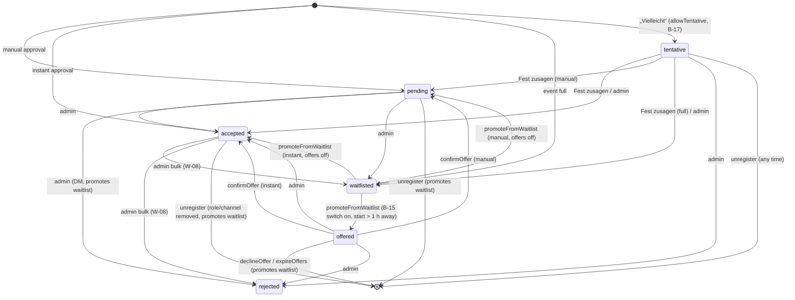

# Registration flow — rules, statuses, waitlist, guests

> TL;DR: Every registration by a member (web or Discord) goes through `registerUserForEvent()` in `utils/registrationService.js`; admins add members with `addRegistrationByAdmin()` (accepted at once, member rules skipped, W-06). It checks event status, duplicates, role requirement, guest permission and required form fields, then decides the status (slot events: main role, else first free fallback role, else waitlist): `waitlisted` when capacity (incl. guests) is exceeded, otherwise `accepted` (instant approval) or `pending` (manual). Admins move registrations between statuses; freed places promote the oldest waitlisted registration that fits. Events with `allowTentative` also take a non-binding „Vielleicht“ (`tentative`, the Ersatzbank, B-17) that holds no place.

## Checks in order (`registerUserForEvent`)

1. Event exists → else `event_not_found` (404).
2. `status === 'active'` (or unset) → else `event_inactive`; then the event must not be over (`isEventOver`: end, else start + 2 h) → else `event_ended` (400, "Das Event ist schon vorbei.", W-01); then the optional `registrationDeadline` must not be reached (`isRegistrationClosed` in `utils/eventListing.js`) → else `registration_closed` (400, "Die Anmeldung für dieses Event ist geschlossen.", W-03).
3. No registration with same `eventId` + `userId` → else `already_registered`.
4. `accessMode === 'role-required'` → user must have one of `requiredRoles` (`missing_role`, 403). Web: roles from the session; Discord: live member roles.
5. Guests sent but `allowGuests === false` → `guests_not_allowed`.
6. `sanitizeFormAnswers(formFields, formAnswers)` keeps only answers to the event form (labels of its fields, form order; checkbox strict `true`/`false`, other answers strings of at most 2000 characters, a dropdown only with one of its options; no form → `{}`), then `findMissingRequiredFields` → `missing_fields` (checkbox must be `true`, others non-empty).
6a. `loadValidGuests(guests, user.id)`: only the guest **ids** of the request count; each must be a stored user (`users/<id>`) with `acceptInvitations !== false` and not the member themself, at most `MAX_GUESTS` = 10, duplicates once → else `invalid_guests` (400) with a German reason; name and avatar come from the stored profile.
7. Slot events: `slotId` must be a slot of the event (`invalid_slot`, 400) and guests are refused (`guests_not_allowed`); `pickSlot` gives the main role, else the first free fallback (`altSlotIds`, slot order), else `waitlisted` — see [role-slots](role-slots.md).
8. Events without slots, capacity (only if `maxParticipants > 0`): occupied = `countOccupiedPlaces` (`utils/capacity.js`: 1 + guests + open guest invitations per pending/accepted registration); if `occupied + 1 + newGuests > max` → `waitlisted`. The same count is what members see: `summarizePlaces`/`formatPlaces` build the sentence "5 von 20 Plätzen belegt (inkl. 1 Gast, 1 Anfrage offen)" for the event page, the overview cards and Discord.
9. Otherwise `approvalMode === 'instant'` → `accepted`, else `pending`.
10. Write the registration (`source: web|discord`; admin entries use `admin`, see below), send guest invitation DMs, then `notifyRegistration` (DM by status; accepted → `assignRole` + event channel access; the waitlisted DM is skipped for members who switched "Warteliste" off, W-16 — the move-up DM of `announcePromotions` always goes out) and `notifyRegistrationsChanged` (live announcement).

Steps 1–10 up to the write run under `withEventLock(eventId)` (one registration per event at a time); DMs and the announcement refresh run after the lock is released.

Maintenance: `registrationDisabled`/`panicMode` block registrations before step 1 (web: `checkRegistrationAllowed` → 503; Discord: `checkRegistrationConditions`).

## Waitlist offers (B-15)

With the bot center switch „Nachrücken bestätigen“ on (`waitlistConfirmation`, default on) a freed place is **offered** instead of filled: `promoteFromWaitlistLocked` writes `status: 'offered'`, `offer: { offeredAt, expiresAt }` and the held slot. `offerDeadline` (`utils/waitlistOffers.js`): now + `waitlistConfirmHours` (bot center, 1–72, default 12), never later than 1 h before the start; no start, less than 1 h to go or switch off → the old instant move-up.

- `offered` is in `OCCUPYING_STATUSES` (`utils/capacity.js`): it holds its places (guests too) and slot, and is no longer on the waitlist (positions of the others move up). Unregistering an offered member frees the place like any other.
- The member gets the offer DM (`sendWaitlistOffer`, `bot/waitlistOffers.js`) with „Platz annehmen“ (`offer_confirm:<registrationId>`), „Doch nicht“ (`offer_decline:<registrationId>`) and „Zum Event“ — always, also with „Warteliste“ DMs off (W-16) or „DM-Benachrichtigungen“ off, because they have to act. The event page shows `#detail-offer` with the same two answers (`POST /api/events/:id/offer/confirm|decline`).
- `confirmOffer` (under the event lock; own, still offered, deadline ahead, event active and not over) → `accepted` / `pending` by `approvalMode`, `offer: null`, then `completePromotion` (`utils/eventUtils.js`, the same effects as an instant move-up without its DM: welcome, role, channels; pending → approval request). Refusals: `missing`, `not_yours`, `not_offered`, `expired`.
- `declineOffer` deletes the registration and runs `promoteFromWaitlist` (the next entry gets an offer). `expireOffers` (offer scheduler, after `whenBotSettled`, every 5 min) deletes expired offers, DMs „⌛ Dein Platz bei **…** ist verfallen – du bist nicht mehr angemeldet.“ (`sendAutomaticDM`) and hands the place on; offers of events that are no longer active or over go quietly.
- Admins decide an offered registration like a waitlisted one (single ✓/✗, bulk accept/waitlist/reject); every decision clears `offer`.
- Shown as „⏳ Platz angeboten – bestätigen bis …“ (`/meine-events`, `/event info`), „Platz angeboten · bis …“ (profile, event cards), „Angeboten · bis …“ (admin dialog).

## „Vielleicht“ / Ersatzbank (B-17)

Events with `allowTentative: true` (wizard switch „„Vielleicht“ erlauben“, default off, kept in templates and series) take a non-binding answer: status `tentative`.

- **Answer:** `registerUserForEvent({ …, tentative: true })` (web `POST /api/events/:id/register` with `tentative: true`, Discord button `event_maybe:<eventId>` → `bot/tentative.js`). Same checks as a registration (steps 1–7 above, form included), plus `tentative_not_allowed` (400, „Für dieses Event gibt es kein „Vielleicht“.“) without the switch; guests are refused. Written as `status: 'tentative'`, `tentativeAt = createdAt`; slot events keep the wanted role (`preferredSlotId`, cleaned `altSlotIds`) with `slotId: null`. Answer „Du stehst auf der Ersatzbank.“. No DM, role, channel access or approval request; only the announcement refresh.
- **No place:** `tentative` is outside `OCCUPYING_STATUSES`, so it is not counted in places or slots, has no waitlist position, never moves up and gets no reminder or check-in. A full event still takes the answer. `summarizePlaces` counts it as `bench`, `describePlaces` adds `benchText` („2 auf der Ersatzbank“).
- **„Fest zusagen“:** `confirmTentativeRegistration` (`utils/tentativeRegistration.js`, `POST /api/events/:id/register/confirm`) under the event lock: own registration must be `tentative` (`not_tentative`, „Du stehst nicht auf der Ersatzbank.“), event active, not over, registration deadline not reached (existing messages; the answer stays on the bench). Status as for a new registration now via `decideStatus` (`utils/slotService.js`): accepted / pending / waitlisted, slot events the wanted role or a free fallback. Sets `createdAt` to now (the waitlist order), keeps `tentativeAt`; then the DM, role and channels of `notifyRegistration`, the approval request for pending.
- **Leaving the bench in any way** (confirm, single admin action, bulk action) sets `createdAt` to the time of the move, so an old „Vielleicht“ never jumps ahead of the waitlist.
- **Withdraw:** `unregisterUserFromEvent` skips the unregister deadline for `tentative`; no DM.
- **Role switch:** `switchOwnSlot` on a tentative registration only changes the wanted role („Deine Wunschrolle ist jetzt …“), never takes a slot.
- **Admins:** accept (free wanted role or overbook with warning), waitlist or reject a tentative registration with the single action; bulk accept/waitlist/reject include it; unselected tentative registrations hold no place.
- **Shown as** „Vielleicht (Ersatzbank)“ (event page card with „Fest zusagen“ / „Abmelden“, `/meine-events`), „Vielleicht“ (profile, cards, admin dialog, member details; the CSV keeps the code `tentative`), „Vielleicht seit …“ in the admin dialog for a registration that came from the bench. The event page lists the bench under the participants (`GET /api/events/:id/participants` → `bench`: display name, avatar, on slot events `preferredSlotId`); Discord announcements show `🤔 **Ersatzbank:** N`.

## Waitlist position (W-05)

A waitlisted registration's place is its rank among the event's waitlisted registrations by `createdAt`, oldest first (ties by id) — `waitlistPositions` in `utils/capacity.js`, the same order the promotion walks. Slot events use the same single list, although a later registration whose wanted role frees up can move up first; the event page says so. Members see only their own place: "Platz 2 von 3 auf der Warteliste" on the event page, "Warteliste · Platz 2 von 3" in the profile's upcoming list; admins see "Warteliste · Platz 2" in the registrations dialog. Discord texts carry no place.

## Status transitions

Admin changes go through `PUT /api/admin/registrations/:id/status` (allowed targets: `accepted`, `rejected`, `waitlisted`; DMs for accepted and rejected via `notifyStatusChange` in `utils/registrationService.js`, no DM for waitlisted). On slot events, accepting a registration without a slot picks a free wanted slot or overbooks the main role (response `warning`); rejecting and waitlisting clear `slotId`. Slots change via `PUT /api/admin/registrations/:id/slot` (admin, may overbook) and `PUT /api/events/:id/register/slot` (member, free slots only, `event_ended` once the event is over, `registration_closed` once the registration deadline is reached).

Discord after the end: `canRegisterViaDiscord` is false, so a refreshed announcement keeps only "Zum Event"; an old button (`checkRegistrationConditions`) and a modal sent after the end (`handleEventRegisterModal`, `handleEventSlotModal`) answer ephemerally "Das Event ist schon vorbei.". After the registration deadline the same places answer "Die Anmeldung für dieses Event ist geschlossen." (W-03).

## Approval in Discord (B-06)

Pending registrations can also be decided in the approval channel of the bot center: the request message's buttons run `changeRegistrationStatus({ …, expectStatus: 'pending' })` from `utils/registrationStatus.js` — the same function as `PUT /api/admin/registrations/:id/status` (slot choice, DM, waitlist moves up after a rejection, audit log with the deciding admin). A request decided elsewhere stays as it is. Every way a request ends closes its message; see [discord-integration](discord-integration.md).

## Bulk actions (W-08)

`POST /api/admin/events/:id/registrations/bulk` changes up to 200 registrations of one event at once (dialog: checkboxes + action bar). Accept applies to pending/waitlisted/offered/tentative, waitlist to pending/accepted/offered/tentative, reject to all of them; the rest is skipped. Accept goes oldest first and **never overbooks**, unlike the single ✓: it fills `maxParticipants` next to the places of the unselected pending/accepted registrations (guests and open invitations count), on slot events the main or a fallback role with a free place; what does not fit goes on the waitlist (`full`). Every changed member gets the DM of the single action, and a newly waitlisted one the waitlist DM (W-16 choice respected). Waitlisting alone moves nobody up; rejections promote the waitlist once. Rules: `planBulkAction` in [utils](../modules/utils.md).

## Entry points

| Channel | Path |
|---|---|
| Web | `POST /api/events/:id/register` → `submitRegistration()` in `public/js/events/registration-form.js` |
| Discord button | `event_register:<eventId>` → `handleEventRegisterButton` → pre-checks → modal if the event has form fields that fit (≤5) → `handleEventRegisterModal` → `completeDiscordRegistration` → `registerUserForEvent({ source: 'discord' })` → `ensureUserProfile` |
| Discord `/register` (`/anmelden`, B-03) | `handleRegisterCommand` (`bot/commands.js`) → no slots: `handleEventRegisterButton` as above; slots: pre-checks → private answer with the `event_slot:` buttons → slot button path below |
| Discord slot button | `event_slot:<eventId>:<slotId>` → `handleEventSlotButton` → slot modal (`alt_slots` select + form) → `handleEventSlotModal` → `completeDiscordRegistration({ slotId, altSlotIds })` |
| Admin entry (W-06) | registrations dialog → `GET /api/admin/events/:id/member-search?q=` (Discord member search, hits marked `alreadyRegistered`) → `POST /api/admin/events/:id/registrations { userId, slotId? }` → `fetchGuildMember` (404 no member, 503 Discord unreachable) → `addRegistrationByAdmin` (see below) |
| „Vielleicht“ (B-17) | web: „Vielleicht“ button (`answerTentative` in `public/js/events/bench.js`) → `POST /api/events/:id/register` with `tentative: true`; Discord: `event_maybe:<eventId>` → `handleTentativeButton` → modal `event_maybe_modal:<eventId>` (form fields, „Wunschrolle“ select on events with more than one slot) when needed → `registerUserForEvent({ tentative: true, source: 'discord' })`; confirm: `POST /api/events/:id/register/confirm` |
| Unregister | `unregisterUserFromEvent`: web `DELETE /api/events/:id/register`, Discord `/unregister` and the "Abmelden" button; refused with `unregister_closed` (400, "Abmelden ist nicht mehr möglich. Wende dich an einen Admin.") once the optional `unregisterDeadline` is reached (`isUnregisterClosed`). Without that deadline members can unregister any time, even after the end. |

## Admin entry (W-06)

`addRegistrationByAdmin({ eventId, member, slotId })` in `utils/registrationService.js` is the second writer next to `registerUserForEvent`, also under `withEventLock`. It skips the member rules on purpose: no role, required-field, deadline, end or archive check. Only `draft` and `cancelled` refuse it (`admin_add_not_allowed`, 400). A member who already has a registration or is a guest (accepted or invited) of one is refused with `already_registered` ("Dieses Mitglied ist schon angemeldet."; shared check `isOnRegistrationList`). The registration is written as `status: accepted`, `source: admin`, empty `formAnswers`, no guests; slot events need an existing `slotId` (else `invalid_slot`) and keep it even when full. A full event or slot is overbooked and the answer carries `warning` ("Das Event ist jetzt überbucht (2 von 1 Plätzen)." / "Slot „Tank“ ist jetzt überbucht."). Before the end `notifyRegistration` sends the accepted message and grants role and channels; after the end nothing is sent. Always `notifyRegistrationsChanged`; the route logs `ADD_REGISTRATION`.

## Guests

- Inviting: the registrant picks users via `GET /api/user/search` (only users with `acceptInvitations !== false`, 60 searches per minute and member); the server checks them again (step 6a) and stores them in `pendingGuests` with `status: 'pending'` and the name/avatar of their profile and receive a DM with `guest_accept` / `guest_decline` buttons.
- Accept → `pendingGuests[i].status = 'accepted'` and user id pushed to `guests`; decline → removed from `pendingGuests` and the waitlist may move up (the invitation no longer reserves a place). Only the invited user can press the buttons. `handleGuestButton` (`bot/guests.js`) re-reads and writes the registration inside `withEventLock`, so two guests answering at once both count; DMs and the waitlist step run after the lock.
- Pending invitations already reserve a slot.
- When the inviting registration leaves `accepted` (single change, bulk action), the check-ins of its guests are taken back with its own (`clearedCheckins` in `utils/participations.js`; invitation times stay).
- An accepted guest has no registration of their own: `GET /api/events/:id/my-registration` answers `{ registered: true, asGuest: true, id, status }` with the id and status of the inviting registration and nothing else from it.

## Message templates

DM texts come from `event.customBotMessages[status]`, else `botMessages/templates[status]`, else a German default. Variables: `{user.id}`, `{user.name}`, `{user.mention}`, `{event.title}`, `{event.url}`, `{role.name}`, `{role.mention}`, `{slot.name}`, `{slot.emoji}` (replaced by `parseTemplate`).

## Gotchas

- Registrations of one event are serialized by `withEventLock` (in memory, single process); a second server process would need a real transaction.
- Promotion moves up every waitlisted registration that still fits (guests counted), oldest first — but never once the event is over (`promoteFromWaitlistLocked` returns no promotion, W-01).
- The registration deadline (W-03) only stops new registrations and own slot switches; waitlist promotion, guest invitation answers and admin changes go on until the end. The unregister deadline only stops members; admins still reject, waitlist or move registrations.
