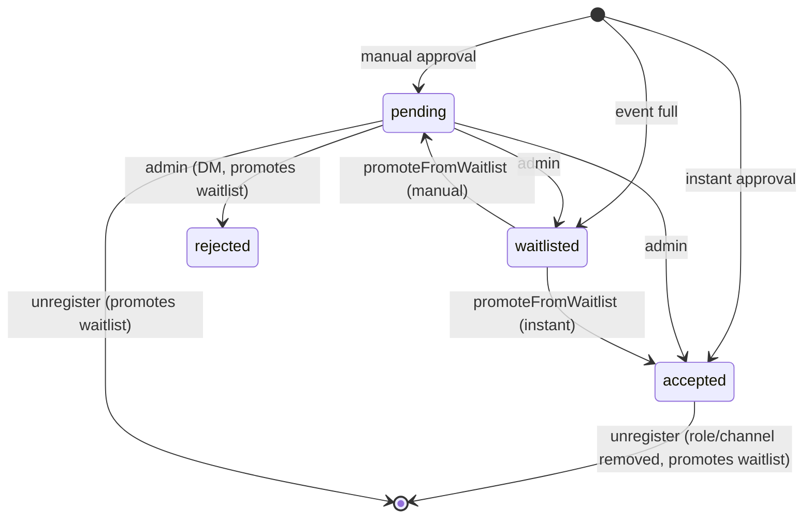

# Registration flow — rules, statuses, waitlist, guests

> TL;DR: Every registration (web or Discord) goes through `registerUserForEvent()` in `utils/registrationService.js`. It checks event status, duplicates, role requirement, guest permission and required form fields, then decides the status (slot events: main role, else first free fallback role, else waitlist): `waitlisted` when capacity (incl. guests) is exceeded, otherwise `accepted` (instant approval) or `pending` (manual). Admins move registrations between statuses; freed places promote the oldest waitlisted registration that fits.

## Checks in order (`registerUserForEvent`)

1. Event exists → else `event_not_found` (404).
2. `status === 'active'` (or unset) → else `event_inactive`; then the event must not be over (`isEventOver`: end, else start + 2 h) → else `event_ended` (400, "Das Event ist schon vorbei.", W-01).
3. No registration with same `eventId` + `userId` → else `already_registered`.
4. `accessMode === 'role-required'` → user must have one of `requiredRoles` (`missing_role`, 403). Web: roles from the session; Discord: live member roles.
5. Guests sent but `allowGuests === false` → `guests_not_allowed`.
6. `findMissingRequiredFields(formFields, formAnswers)` → `missing_fields` (checkbox must be `true`, others non-empty).
7. Slot events: `slotId` must be a slot of the event (`invalid_slot`, 400) and guests are refused (`guests_not_allowed`); `pickSlot` gives the main role, else the first free fallback (`altSlotIds`, slot order), else `waitlisted` — see [role-slots](role-slots.md).
8. Events without slots, capacity (only if `maxParticipants > 0`): occupied = `countOccupiedPlaces` (`utils/capacity.js`: 1 + guests + open guest invitations per pending/accepted registration); if `occupied + 1 + newGuests > max` → `waitlisted`. The same count is what members see: `summarizePlaces`/`formatPlaces` build the sentence "5 von 20 Plätzen belegt (inkl. 1 Gast, 1 Anfrage offen)" for the event page, the overview cards and Discord.
9. Otherwise `approvalMode === 'instant'` → `accepted`, else `pending`.
10. Write the registration (`source: web|discord`), send guest invitation DMs, then `notifyRegistration` (DM by status; accepted → `assignRole` + event channel access) and `notifyRegistrationsChanged` (live announcement).

Steps 1–10 up to the write run under `withEventLock(eventId)` (one registration per event at a time); DMs and the announcement refresh run after the lock is released.

Maintenance: `registrationDisabled`/`panicMode` block registrations before step 1 (web: `checkRegistrationAllowed` → 503; Discord: `checkRegistrationConditions`).

## Status transitions

Admin changes go through `PUT /api/admin/registrations/:id/status` (allowed targets: `accepted`, `rejected`, `waitlisted`). On slot events, accepting a registration without a slot picks a free wanted slot or overbooks the main role (response `warning`); rejecting and waitlisting clear `slotId`. Slots change via `PUT /api/admin/registrations/:id/slot` (admin, may overbook) and `PUT /api/events/:id/register/slot` (member, free slots only, `event_ended` once the event is over).

Discord after the end: `canRegisterViaDiscord` is false, so a refreshed announcement keeps only "Zum Event"; an old button (`checkRegistrationConditions`) and a modal sent after the end (`handleEventRegisterModal`, `handleEventSlotModal`) answer ephemerally "Das Event ist schon vorbei.".

## Entry points

| Channel | Path |
|---|---|
| Web | `POST /api/events/:id/register` → `submitRegistration()` in `public/js/events/registration-form.js` |
| Discord button | `event_register:<eventId>` → `handleEventRegisterButton` → pre-checks → modal if the event has form fields that fit (≤5) → `handleEventRegisterModal` → `completeDiscordRegistration` → `registerUserForEvent({ source: 'discord' })` → `ensureUserProfile` |
| Discord slot button | `event_slot:<eventId>:<slotId>` → `handleEventSlotButton` → slot modal (`alt_slots` select + form) → `handleEventSlotModal` → `completeDiscordRegistration({ slotId, altSlotIds })` |
| Unregister | `unregisterUserFromEvent`: web `DELETE /api/events/:id/register`, Discord `/unregister` and the "Abmelden" button |

## Guests

- Inviting: the registrant picks users via `GET /api/user/search` (only users with `acceptInvitations !== false`); they are stored in `pendingGuests` with `status: 'pending'` and receive a DM with `guest_accept` / `guest_decline` buttons.
- Accept → `pendingGuests[i].status = 'accepted'` and user id pushed to `guests`; decline → removed from `pendingGuests` and the waitlist may move up (the invitation no longer reserves a place). Only the invited user can press the buttons.
- Pending invitations already reserve a slot.
- An accepted guest has no registration of their own: `GET /api/events/:id/my-registration` answers `{ registered: true, asGuest: true, id, status }` with the id and status of the inviting registration and nothing else from it.

## Message templates

DM texts come from `event.customBotMessages[status]`, else `botMessages/templates[status]`, else a German default. Variables: `{user.id}`, `{user.name}`, `{user.mention}`, `{event.title}`, `{event.url}`, `{role.name}`, `{role.mention}`, `{slot.name}`, `{slot.emoji}` (replaced by `parseTemplate`).

## Gotchas

- Registrations of one event are serialized by `withEventLock` (in memory, single process); a second server process would need a real transaction.
- Promotion moves up every waitlisted registration that still fits (guests counted), oldest first — but never once the event is over (`promoteFromWaitlistLocked` returns no promotion, W-01).
