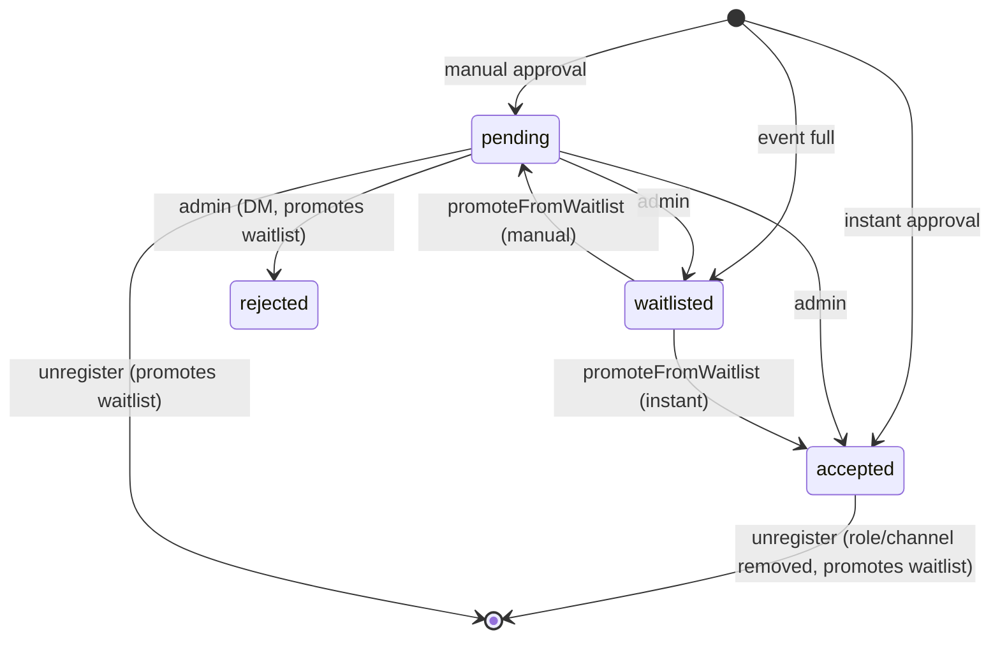

# Registration flow — rules, statuses, waitlist, guests

> TL;DR: Every registration (web or Discord) goes through `registerUserForEvent()` in `utils/registrationService.js`. It checks event status, duplicates, role requirement, guest permission and required form fields, then decides the status: `waitlisted` when capacity (incl. guests) is exceeded, otherwise `accepted` (instant approval) or `pending` (manual). Admins move registrations between statuses; freed slots promote the oldest waitlisted registration.

## Checks in order (`registerUserForEvent`)

1. Event exists → else `event_not_found` (404).
2. `status === 'active'` (or unset) → else `event_inactive`.
3. No registration with same `eventId` + `userId` → else `already_registered`.
4. `accessMode === 'role-required'` → user must have one of `requiredRoles` (`missing_role`, 403). Web: roles from the session; Discord: live member roles.
5. Guests sent but `allowGuests === false` → `guests_not_allowed`.
6. `findMissingRequiredFields(formFields, formAnswers)` → `missing_fields` (checkbox must be `true`, others non-empty).
7. Capacity (only if `maxParticipants > 0`): occupied = Σ over pending+accepted registrations of `1 + guests.length + pending guest invitations`; if `occupied + 1 + newGuests > max` → `waitlisted`.
8. Otherwise `approvalMode === 'instant'` → `accepted`, else `pending`.
9. Write the registration (`source: web|discord`), send guest invitation DMs, then `notifyRegistration` (DM by status; accepted → `assignRole` + event channel access).

Maintenance: `registrationDisabled`/`panicMode` block registrations before step 1 (web: `checkRegistrationAllowed` → 503; Discord: `checkRegistrationConditions`).

## Status transitions

Admin changes go through `PUT /api/admin/registrations/:id/status` (allowed targets: `accepted`, `rejected`, `waitlisted`).

## Entry points

| Channel | Path |
|---|---|
| Web | `POST /api/events/:id/register` → `submitRegistration()` in `app.js` |
| Discord button | `event_register:<eventId>` → `handleEventRegisterButton` → pre-checks → modal if the event has form fields that fit (≤5) → `handleEventRegisterModal` → `completeDiscordRegistration` → `registerUserForEvent({ source: 'discord' })` → `ensureUserProfile` |
| Unregister | web `DELETE /api/events/:id/register`; Discord `/unregister` |

## Guests

- Inviting: the registrant picks users via `GET /api/user/search` (only users with `acceptInvitations !== false`); they are stored in `pendingGuests` with `status: 'pending'` and receive a DM with `guest_accept` / `guest_decline` buttons.
- Accept → `pendingGuests[i].status = 'accepted'` and user id pushed to `guests`; decline → removed from `pendingGuests`. Only the invited user can press the buttons.
- Pending invitations already reserve a slot.

## Message templates

DM texts come from `event.customBotMessages[status]`, else `botMessages/templates[status]`, else a German default. Variables: `{user.id}`, `{user.name}`, `{user.mention}`, `{event.title}`, `{event.url}`, `{role.name}`, `{role.mention}` (replaced by `parseTemplate`).

## Gotchas

- `promoteFromWaitlist` counts registrations without guests (inconsistent with step 7).
- A double click on the Discord button is guarded only in memory (`pendingDiscordRegistrations`).
