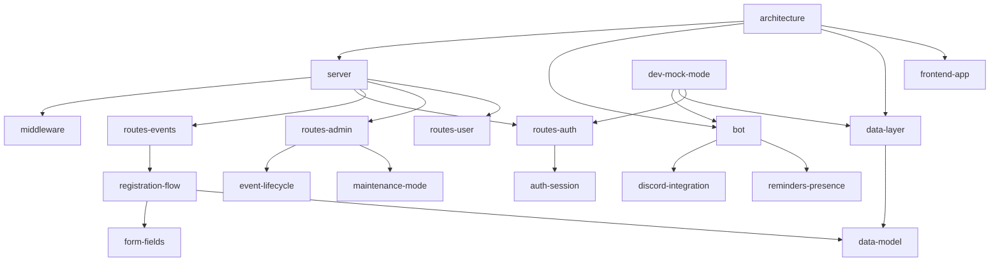

# DEMS wiki — entry point

> TL;DR: Knowledge graph of the DEMS codebase for coding agents and humans. Each page is a node with frontmatter (id, type, tags, sources, typed edges) and a one-line TL;DR; `graph.json` holds all nodes, summaries and edges for cheap retrieval. Start here, pick the smallest set of nodes for your task, then open source files at the given grep anchors.

## How to use this wiki (agents)

1. Find candidate nodes: the task table below, the file → node table, or `graph.json` — it stores one node per line, so `grep '"<tag or file>"' docs/wiki/graph.json` returns whole nodes (summary, tags, sources, neighbours).
2. Read only those nodes. Follow `depends_on` for prerequisites, `see_also` for neighbours, `used_by` (derived) to see impact.
3. Open code at the function/section names the node gives (`grep -n "function <name>" <file>`), never whole large files.
4. After changing behaviour: update the node(s), run `npm run wiki`.

## Nodes

| Type | Nodes |
|---|---|
| overview | [architecture](overview/architecture.md) · [directory-map](overview/directory-map.md) · [request-lifecycle](overview/request-lifecycle.md) |
| module | [server](modules/server.md) · [routes-auth](modules/routes-auth.md) · [routes-events](modules/routes-events.md) · [routes-admin](modules/routes-admin.md) · [routes-user](modules/routes-user.md) · [bot](modules/bot.md) · [data-layer](modules/data-layer.md) · [middleware](modules/middleware.md) · [utils](modules/utils.md) · [frontend-app](modules/frontend-app.md) · [frontend-markup](modules/frontend-markup.md) · [dev-mock-mode](modules/dev-mock-mode.md) · [landing-page](modules/landing-page.md) |
| concept | [data-model](concepts/data-model.md) · [registration-flow](concepts/registration-flow.md) · [form-fields](concepts/form-fields.md) · [auth-session](concepts/auth-session.md) · [maintenance-mode](concepts/maintenance-mode.md) · [discord-integration](concepts/discord-integration.md) · [reminders-presence](concepts/reminders-presence.md) · [event-lifecycle](concepts/event-lifecycle.md) · [security](concepts/security.md) |
| ops | [configuration](ops/configuration.md) · [docker](ops/docker.md) · [deployment](ops/deployment.md) · [testing](ops/testing.md) |
| howto | [add-api-endpoint](howto/add-api-endpoint.md) · [add-event-field](howto/add-event-field.md) · [add-form-field-type](howto/add-form-field-type.md) · [add-bot-feature](howto/add-bot-feature.md) · [add-collection](howto/add-collection.md) · [run-and-debug](howto/run-and-debug.md) |
| reference | [api-index](reference/api-index.md) · [glossary](reference/glossary.md) · [known-issues](reference/known-issues.md) · [conventions](reference/conventions.md) · [decisions](reference/decisions.md) |

## Task → nodes

| I want to ... | Read |
|---|---|
| understand the system quickly | architecture → directory-map |
| add or change an endpoint | add-api-endpoint, api-index, the router node |
| change how registrations work | registration-flow, data-model, utils |
| add an event field | add-event-field, data-model |
| touch registration forms | form-fields, add-form-field-type |
| change Discord behaviour | bot, discord-integration, add-bot-feature |
| reminders / bot status / presence | reminders-presence |
| login, sessions, admin rights | auth-session, routes-auth |
| maintenance / panic mode | maintenance-mode |
| frontend UI change | frontend-app, frontend-markup |
| database / new collection | data-layer, data-model, add-collection |
| run locally / debug | run-and-debug, dev-mock-mode |
| write tests | testing |
| configure / deploy | configuration, docker, deployment |
| security-sensitive change | security, known-issues |
| translate a German term from a ticket | glossary |

## File → nodes

| Path | Nodes |
|---|---|
| `server.js` | server, request-lifecycle, security |
| `bot.js` | bot, discord-integration, reminders-presence, form-fields |
| `firebaseAdmin.js`, `db/sqliteAdapter.js` | data-layer |
| `routes/auth.js` | routes-auth, auth-session |
| `routes/events.js` | routes-events, registration-flow, event-lifecycle |
| `routes/admin.js` | routes-admin, event-lifecycle, maintenance-mode |
| `routes/user.js` | routes-user |
| `middleware/*.js` | middleware, maintenance-mode, auth-session |
| `utils/registrationService.js` | registration-flow, utils |
| `utils/formFields.js` | form-fields, utils |
| `utils/eventUtils.js`, `utils/userProfile.js`, `utils/debugLog.js` | utils |
| `public/js/app.js` | frontend-app |
| `public/index.html`, `public/css/style.css` | frontend-markup |
| `dev/*` | dev-mock-mode |
| `test/*` | testing |
| `Dockerfile`, `compose*.yaml` | docker, deployment |
| `.env.example` | configuration |
| `landing/*` | landing-page |

## Graph (main edges)



## Node format (enforced by `scripts/wiki-graph.js`)

```yaml
---
id: kebab-case-id            # must equal the file name
title: Human title
type: concept                # overview | module | concept | ops | howto | reference
tags: [a, b]                 # retrieval keywords
sources: [path/from/repo]    # files/dirs the node documents (must exist)
depends_on: [other-id]       # prerequisite knowledge  -> reverse: used_by
part_of: [other-id]          # containment             -> reverse: parts
see_also: [other-id]         # related (symmetric)
---
# Title

> TL;DR: one or two self-contained sentences (used as the node summary)
```

Rules: one topic per node; TL;DR first; code locations as file + function/section name (no line numbers); relative links between nodes; `npm run wiki` after every change (the test in `test/wiki.test.js` fails on broken edges, missing sources, broken links or a stale `graph.json`).

`graph.json` schema: `{ nodes: [{ id, title, type, path, summary, tags, sources, depends_on, used_by, part_of, parts, see_also }], edges: [{ from, to, type }] }`.
