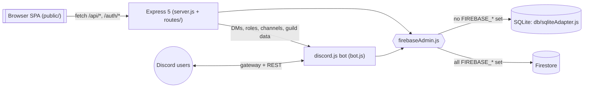

# System architecture

> TL;DR: DEMS is ONE Node.js process: an Express 5 server (REST API + static single-page app) and a discord.js bot that share one data layer — the Firestore client SDK, or a local SQLite adapter that mimics the same API when no Firebase config is set. The browser SPA (vanilla JS, Bootstrap, no build step) only talks to the REST API; Discord users only talk to the bot.

## Components

| Component | Files | Role | Node |
|---|---|---|---|
| HTTP server | `server.js` | middleware chain, mounts routers, misc endpoints, SPA fallback, starts the bot | [server](../modules/server.md) |
| REST routers | `routes/*.js` | `/auth`, `/api/events`, `/api/admin`, `/api/user` | [api-index](../reference/api-index.md) |
| Discord bot | `bot.js` (entry) + `bot/*.js` (area modules) | slash commands, buttons/modals, DMs, roles, channels, reminders, presence | [bot](../modules/bot.md) |
| Data layer | `firebaseAdmin.js`, `db/sqliteAdapter.js` | Firestore-compatible API, backend chosen at startup | [data-layer](../modules/data-layer.md) |
| Middleware | `middleware/*.js` | auth guards, maintenance gates, input validation | [middleware](../modules/middleware.md) |
| Domain helpers | `utils/*.js` | registration service, form fields, waitlist, audit log, profiles, debug log | [utils](../modules/utils.md) |
| Frontend | `public/` | SPA: `index.html` + `js/main.js` with ES modules per area (`js/core`, `js/events`, `js/polls`, `js/admin`, `js/pages`) + `css/style.css` + vendored libs | [frontend-app](../modules/frontend-app.md), [frontend-markup](../modules/frontend-markup.md) |
| Dev mock mode | `dev/` | runs without Discord/Firebase: persona login, mock bot, seed data | [dev-mock-mode](../modules/dev-mock-mode.md) |
| Landing page | `landing/` | separate static marketing site, NOT served by `server.js` | [landing-page](../modules/landing-page.md) |

## Diagram

## Design decisions that shape every change

- **One data API everywhere.** All code imports `{ db, collection, doc, getDoc, ... }` from `firebaseAdmin.js` and uses the Firestore modular API. Never import `better-sqlite3` or `firebase/firestore` directly. See [data-layer](../modules/data-layer.md).
- **Filter and sort in memory.** Queries avoid Firestore composite indexes: routes fetch with simple `where` clauses and sort/paginate in JS. Data volumes per Discord server are small.
- **Routes call into the bot.** Routes import helpers from `bot.js` (`sendDM`, `assignRole`, `getGuildRoles`, ...). Every bot helper is a no-op returning `false` / `[]` / `null` while the bot is not ready, so the web app works without a bot token.
- **Bot calls back lazily.** The `bot/` modules require `utils/registrationService`, `utils/eventUtils`, `utils/pollStore` and `utils/announcementRefresh` inside functions to avoid a circular `require` (those utils require `bot.js` at load time).
- **No frontend build.** `public/` is served as-is; all libraries and fonts are pinned copies in `public/vendor/` (no CDN).
- **Languages.** UI texts, API error messages and Discord messages are German; code, comments and this wiki are English.

## Process lifecycle

1. `server.js` loads `.env` (dotenv, quiet) and `dev/mockMode.js` (forces the mock environment when `DEV_MOCK=true`).
2. Requiring `bot.js` loads `dev/mockMode.js`, then the `bot/` modules, which load `firebaseAdmin.js` (it picks Firestore or SQLite).
3. Express starts listening (`PORT`, default 3000); a listen error exits with code 1.
4. `startBot(DISCORD_BOT_TOKEN)` logs the bot in (skipped without token), `startReminderScheduler()` starts the 5-minute reminder loop; the poll and archive schedulers follow (the archive's first run waits for `whenBotSettled()`).
5. `SIGINT`/`SIGTERM` → `gracefulShutdown`: close HTTP server, `stopBot()`, exit (forced after 10 s).
